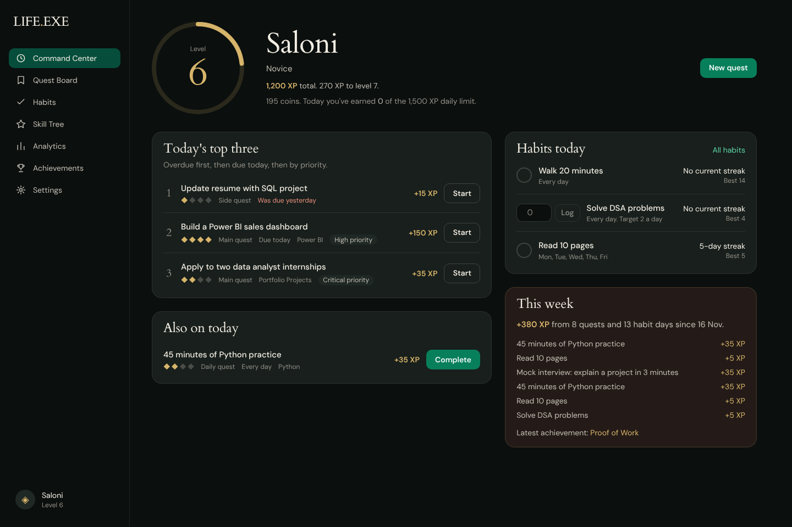

# LIFE.EXE

**Level up your reality.** A gamified personal operating system: quests, an XP ledger, levels, habits, a skill tree that separates practice from proof, and analytics that only say what your data supports.



## What works today (v0.1.0)
- **Quests** with a validated lifecycle (draft → available → active → completed; pause, cancel, expire, restore, reopen), daily/weekly recurrence, search, filters and history.
- **XP that can't be double-counted:** append-only ledger, idempotency keys, a partial unique index per occurrence, one transaction per completion. Twelve simultaneous "complete" requests award XP once (tested).
- **Levels** from `round(100 × (L − 1)^1.5)`, computed with exact integer maths.
- **Habits** with daily, specific-day and N-per-week schedules; rest days and pauses never break streaks; a missed day never costs XP.
- **Skill tree** (32 editable skills, 5 trees) as a DAG with cycle detection; a skill is *demonstrated* only with enough XP **and** evidence.
- **Command Center**, **Analytics** (net XP per day, activity heatmap, attributes, skills, week comparison, insights with their numbers), **Achievements**, **Settings**, JSON **export** and **account deletion**.

Not built yet: study timer, goals, projects, career, finance, wellness, weekly review, reward shop. See the [roadmap](docs/14-roadmap-and-backlog.md) and [known issues](docs/known-issues.md).

## Run it
Requirements: Python 3.12+ and Node 22.
```bash
pip install -r backend/requirements-dev.txt
(cd frontend && npm install && npm run build)
(cd backend && python -m lifeexe)            # http://127.0.0.1:8000
```
Optional demo data: `(cd backend && python scripts/seed_demo.py)` then start with `LIFEEXE_DB_PATH=../data/demo.db` and sign in as `demo@lifeexe.local` / `demo passphrase 123`.

## Verify it
```bash
./scripts/verify.sh      # mypy, ruff, pytest (unit, integration, PostgreSQL schema), tsc, node tests, build, Playwright E2E, perf
```
Latest run: **581 tests passed, 0 failed** ([report](docs/testing/test-execution-report.md)).

## Stack and why
| Layer | Choice | Note |
|---|---|---|
| Backend | Python 3.13, Starlette, Pydantic v2, Uvicorn | FastAPI wasn't installable; a small typed routing layer provides validation and OpenAPI ([ADR-002](docs/adr/ADR-002-starlette-instead-of-fastapi.md)) |
| Data | SQLite runtime, PostgreSQL 16 schema validated in tests | [ADR-003](docs/adr/ADR-003-sqlite-runtime-postgres-schema.md) |
| Frontend | React 19, TypeScript, esbuild, Tailwind v4, hand-built SVG charts | [ADR-004](docs/adr/ADR-004-frontend-toolchain.md) |
| Tests | pytest, Playwright, Node test runner, mypy, ruff, tsc | |

Architecture: a modular monolith with a pure domain layer ([ADR-001](docs/adr/ADR-001-modular-monolith.md), [architecture](docs/04-architecture.md)).

## Repository layout
```
backend/   lifeexe/{api,services,domain,repositories,core}, migrations/{sqlite,postgres}, tests/, scripts/
frontend/  src/{app,pages,components,lib,styles}, scripts/build.mjs, tests/
docs/      charter, SRS, traceability, architecture, database, API, game mechanics, analytics,
           security & privacy, UI/UX, tests, deployment, maintenance, roadmap, manual, ADRs
```

## Documentation
Start at [docs/README.md](docs/README.md), which maps each requested SDLC document to its file.

Fonts: Cardo and DM Sans, both under the SIL Open Font License (`frontend/public/fonts/OFL-*.txt`).
