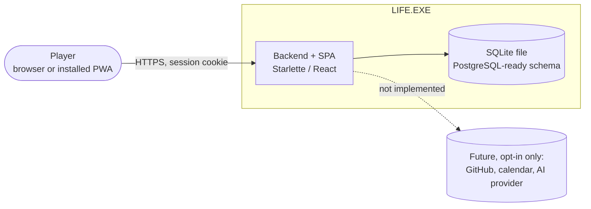
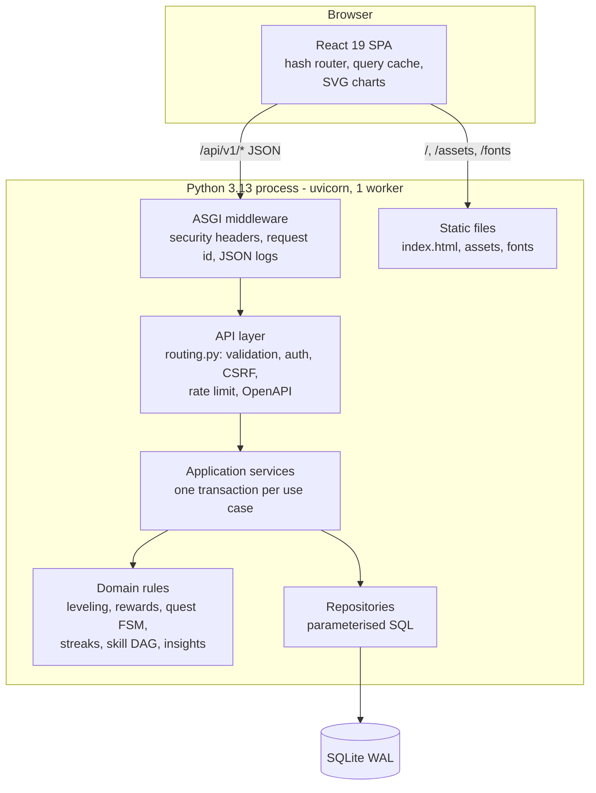
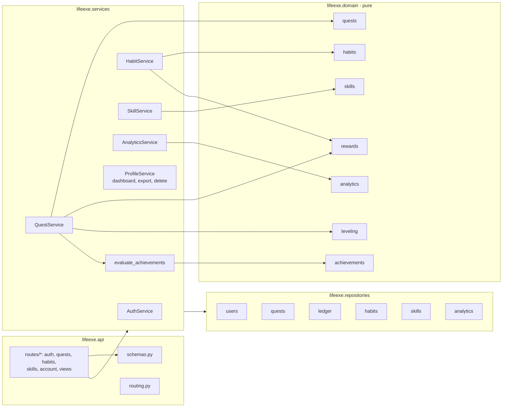
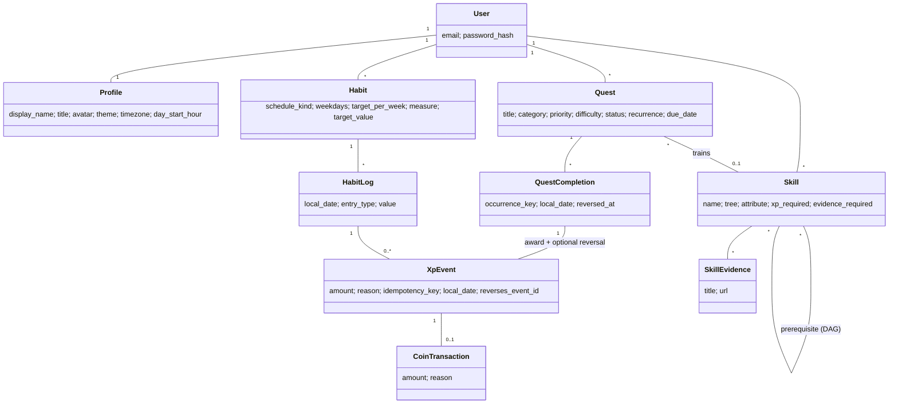
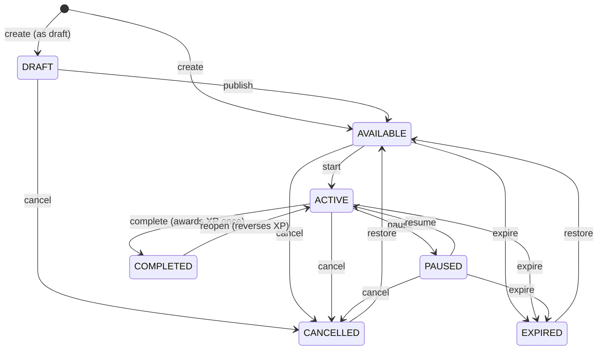
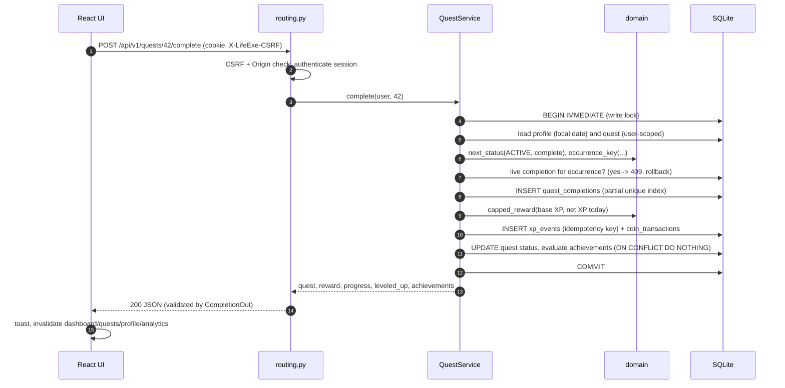
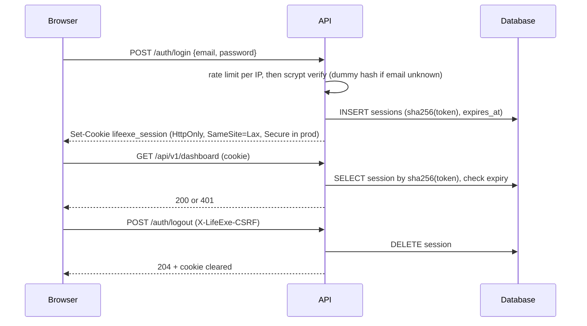
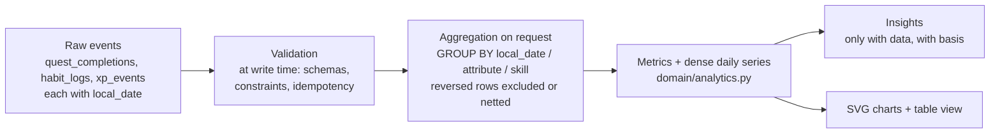
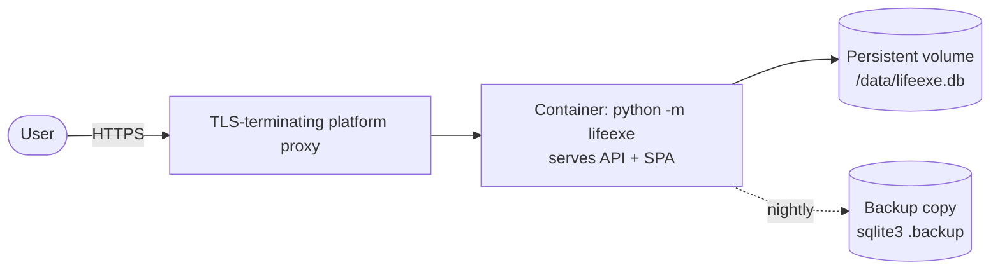

# 04 System architecture

LIFE.EXE is a **modular monolith** (ADR-001): one backend process serves the JSON API and the built single-page app from the same origin. Business rules live in a pure domain layer that has no I/O.

## 1. Context

No third-party service receives personal data in v0.1.

## 2. Containers


## 3. Backend components

Dependency rule: `api -> services -> {domain, repositories}`; `domain` imports nothing from the other layers except the error types in `core/errors.py`.

## 4. Domain model


## 5. Quest state machine

Recurring quests stay `ACTIVE`; *complete* and *reopen* act on the current occurrence (local date or ISO week) and keep the status. `EXPIRED` is never set automatically.

## 6. Sequence: completing a quest (the first vertical slice)


## 7. Authentication flow


## 8. Analytics data flow

Derived statistics are never stored, so they cannot drift from the raw events.

## 9. Frontend structure
```
frontend/src
├─ main.tsx, app/App.tsx         auth gate, routing, theme
├─ lib/                          api client (CSRF), query cache, router, format, types (pure, unit-tested)
├─ components/                   Shell, Sigil, quests, habits, charts, Dialog, feedback (toasts/states)
└─ pages/                        AuthPage, CommandCenter, QuestBoard, HabitsPage, SkillsPage,
                                 AnalyticsPage, AchievementsPage, SettingsPage
```
The UI holds no game rules: it renders `allowed_actions`, `progress`, `stats` and statuses computed by the server.

## 10. Deployment architecture (target)

One container is enough for a personal deployment. Moving to managed PostgreSQL changes only the database box (ADR-003). See `12-deployment.md`.
