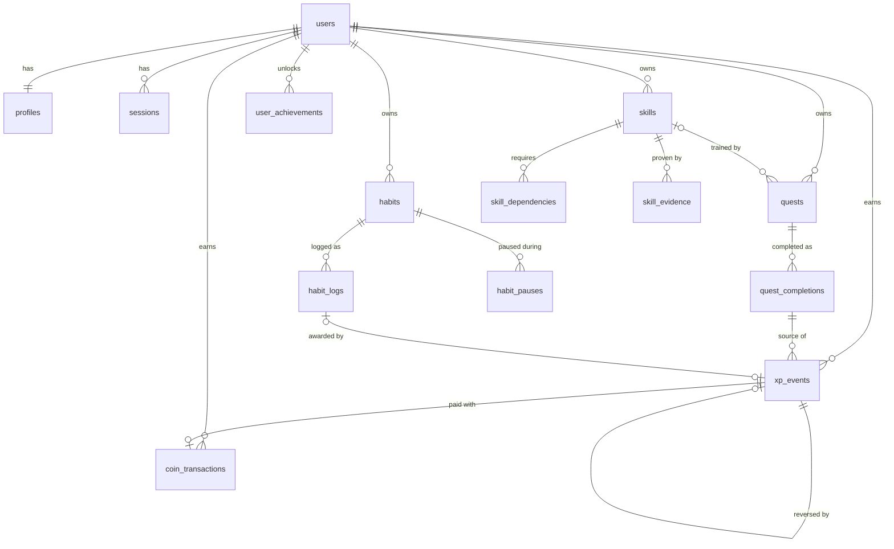

# 05 Database design, ER diagram and data dictionary

Schema files: `backend/migrations/sqlite/0001_initial.sql` (runtime, ADR-003) and `backend/migrations/postgres/0001_initial.sql` (target; validated against PostgreSQL 16 by `tests/postgres`). Both define the same 14 tables, constraints and indexes.

## 1. Entity relationship diagram

## 2. Design principles
- **Ledger, not counters.** Total XP = `SUM(xp_events.amount)`; coins = `SUM(coin_transactions.amount)`. Nothing stores a running total (ADR-005).
- **Database-level integrity, not just application checks.**
  - `ux_quest_completions_live`: partial unique index on `(quest_id, occurrence_key) WHERE reversed_at IS NULL`, so one live completion per occurrence.
  - `UNIQUE (user_id, idempotency_key)` on both ledgers.
  - `ux_xp_events_single_reversal`: a ledger event can be reversed at most once.
  - Sign check: awards are `>= 0`, reversals `<= 0`.
- **Same-user guarantees.** Child tables reference `(parent_id, user_id) -> parent(id, user_id)`, so a quest cannot point at another user's skill, nor a dependency link two users' skills, even through a buggy query.
- **Local dates stored with events** (`local_date`) so analytics and streaks never re-derive days from timestamps (ADR-007).
- **Soft deletion only where justified.** `archived_at` exists on quests (ledger references), skills and habits. Everything else is hard-deleted; account deletion cascades through `users`.
- **Naming.** snake_case plural tables, `id` primary keys, `<entity>_id` foreign keys, `*_at` for UTC instants, `*_date` for local calendar dates, `ix_` indexes, `ux_` unique indexes.

## 3. Data dictionary
Types are given as SQLite / PostgreSQL.

### users
| Column | Type | Constraints | Notes |
|---|---|---|---|
| id | INTEGER / BIGINT identity | PK | |
| email | TEXT | NOT NULL, UNIQUE, lowercase check, 3-254 chars | normalised by the API |
| password_hash | TEXT | NOT NULL | `scrypt$n$r$p$salt$hash` |
| created_at, updated_at | TEXT / TIMESTAMPTZ | NOT NULL | UTC |

### sessions
| Column | Type | Constraints | Notes |
|---|---|---|---|
| id | PK | | |
| user_id | FK users ON DELETE CASCADE | NOT NULL, indexed | |
| token_hash | TEXT | NOT NULL, UNIQUE | SHA-256 of the cookie token |
| created_at, expires_at, last_seen_at | timestamp | NOT NULL | expired rows purged on login |

### profiles
| Column | Type | Constraints | Notes |
|---|---|---|---|
| user_id | PK, FK users CASCADE | | 1:1 with users |
| display_name | TEXT | 1-40 chars | |
| title, avatar, theme | TEXT | NOT NULL | validated against `domain/character.py` |
| timezone | TEXT | NOT NULL | canonical IANA name |
| day_start_hour | INTEGER / SMALLINT | 0-6, default 4 | local hour at which a new day begins |

### quests
| Column | Type | Constraints | Notes |
|---|---|---|---|
| id | PK | UNIQUE (id, user_id) | target of composite FKs |
| user_id | FK users CASCADE | indexed with status, due_date | |
| title | TEXT | 1-120 | |
| description | TEXT | <= 2000 | |
| category | TEXT | MAIN, SIDE, DAILY, WEEKLY, MILESTONE, CHALLENGE, BOSS | label only |
| priority | TEXT | LOW, MEDIUM, HIGH, CRITICAL | |
| difficulty | TEXT | EASY, MEDIUM, HARD, EPIC | determines XP |
| status | TEXT | DRAFT ... EXPIRED | see state machine |
| recurrence | TEXT | NONE, DAILY, WEEKLY | |
| estimated_minutes | INTEGER | NULL or 1-1440 | |
| due_date | TEXT / DATE | nullable | local calendar date |
| completion_criteria | TEXT | <= 500 | |
| skill_id | composite FK skills(id, user_id) | nullable | |
| created_at, updated_at, started_at, completed_at, archived_at | timestamp | | |

### quest_completions
| Column | Type | Constraints | Notes |
|---|---|---|---|
| id | PK | | |
| user_id | FK users CASCADE | | |
| quest_id | composite FK quests(id, user_id) | NO ACTION | blocks hard delete of quests with history |
| occurrence_key | TEXT | partial UNIQUE with quest_id where live | `once`, `YYYY-MM-DD`, `YYYY-Www` |
| local_date | TEXT / DATE | indexed with user_id | |
| completed_at | timestamp | NOT NULL | |
| reversed_at | timestamp | nullable | set when reopened |

### xp_events (append-only ledger)
| Column | Type | Constraints | Notes |
|---|---|---|---|
| id | PK | | |
| user_id | FK users CASCADE | indexed (user, date), (user, skill) | |
| amount | INTEGER | sign check vs reverses_event_id | net XP of this row |
| base_amount | INTEGER | >= 0 | XP before the daily cap |
| reason | TEXT | QUEST_COMPLETED, QUEST_REOPENED, HABIT_COMPLETED, HABIT_UNDONE, CORRECTION | |
| source_type, source_id | TEXT, INTEGER | QUEST_COMPLETION, HABIT_LOG, CORRECTION | polymorphic source |
| skill_id | composite FK skills | nullable | drives skill XP |
| attribute | TEXT | one of 8 or NULL | drives attribute XP |
| idempotency_key | TEXT | UNIQUE (user_id, key) | |
| reverses_event_id | FK xp_events | unique when not null | |
| local_date | TEXT / DATE | NOT NULL | reversals reuse the original's date |
| created_at | timestamp | NOT NULL | |

### coin_transactions
Same ledger pattern: `amount`, `reason` (QUEST_REWARD, QUEST_REWARD_REVERSED, CORRECTION), `xp_event_id`, `UNIQUE (user_id, idempotency_key)`.

### skills, skill_dependencies, skill_evidence
- `skills`: `slug` unique per user, `name`, `tree`, `attribute`, `description`, `xp_required` (0-100000), `evidence_required` (0-50), `archived_at`; `UNIQUE (id, user_id)`.
- `skill_dependencies`: PK `(skill_id, prerequisite_id)`, `CHECK (skill_id <> prerequisite_id)`, both composite FKs to skills with CASCADE. Acyclicity is enforced in the service (`would_create_cycle`), because SQL cannot express it declaratively.
- `skill_evidence`: `title` (1-120), `url` (http/https, <= 500), `notes`.

### habits, habit_logs, habit_pauses
- `habits`: `schedule_kind` (DAILY, WEEKDAYS, WEEKLY_COUNT), `weekdays_mask` (bit 0 = Monday, 1-127), `target_per_week` (required for WEEKLY_COUNT), `measure` (BOOLEAN forces `target_value = 1`), `attribute`, `start_date` (local), `archived_at`.
- `habit_logs`: one row per habit per local day (`UNIQUE (habit_id, local_date)`), `entry_type` ENTRY or REST, `value`, `award_event_id` (live award, if any).
- `habit_pauses`: inclusive date ranges; `end_date NULL` = paused now; at most one open pause per habit (partial unique index).

### user_achievements
PK `(user_id, achievement_key)`; inserted with `ON CONFLICT DO NOTHING` (idempotent). The catalogue lives in code (`domain/achievements.py`).

### schema_migrations
`version` (PK), `name`, `checksum` (SHA-256 of the file), `applied_at`. Editing an applied migration raises an error.

## 4. Transactions and concurrency
- Every write use case runs in a single `BEGIN IMMEDIATE` transaction (SQLite takes the write lock at the start), so check-then-insert sequences (live completion? today's net XP?) are serialised.
- **PostgreSQL equivalent** (for the driver switch): start each write use case with `SELECT 1 FROM profiles WHERE user_id = $1 FOR UPDATE` to serialise writes per user, and keep the unique indexes as the final guard. Default `READ COMMITTED` isolation is then sufficient.
- `busy_timeout` is 15 s; WAL mode lets reads proceed during writes.

## 5. Migrations
`python -m lifeexe` applies pending migrations at start-up (`core/migrations.py`). Each file runs in one transaction with its `schema_migrations` row; failure rolls back both. New changes are new files (`0002_*.sql`) in **both** dialect folders, and `tests/postgres` must keep passing.

## 6. Test fixtures
Integration tests create a fresh database per test under pytest's `tmp_path`; the demo dataset (`backend/scripts/seed_demo.py`) creates three weeks of history through the public API so it obeys every rule.

## 7. Backup and restore
- Online backup: `sqlite3 data/lifeexe.db ".backup 'backups/lifeexe-$(date +%F).db'"` (consistent while the app runs).
- Restore: stop the app, replace the file, start the app (migrations re-check checksums).
- Verify a backup: `sqlite3 backup.db "PRAGMA integrity_check; SELECT COUNT(*) FROM xp_events;"`.
- Logical export per user: `GET /api/v1/account/export`.
